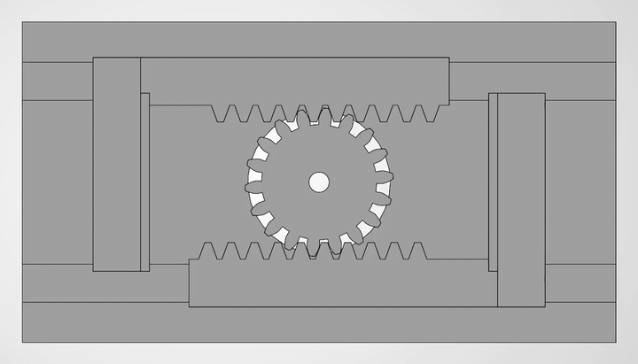

# Force-Controlled Robotic Gripper

A 3D-printable parallel-jaw gripper designed to hold a 512 g water bottle and a raw egg, using force feedback to grip each one just hard enough. A single servo-driven pinion moves two racks in opposite directions, so the jaws close symmetrically and stay parallel.

**Status:** Mechanism designed and verified in CAD (October 2026): gear, racks, fingers, base plate, 37–78 mm travel limits and interference check. Next: servo mount, then printing, FSR force control and testing over winter break 2026–27.

## Requirements

| Requirement | Target | Test | Result |
|---|---|---|---|
| Payload | Hold a 512 g sealed water bottle (Ø 65.3 mm at grip height) for 30 s without slipping | Slip < 2 mm against a marker line, 10 trials | Pending (winter break) |
| Fragile handling | Hold a raw egg within the design range for 10 s without cracking or dropping it | Flashlight crack check, slip < 2 mm, 10 trials | Pending (winter break) |
| Force control | Steady-state force within ±15% of the setpoint at 3 setpoints (egg, bottle, and one midway; 1.8, 7.2, and 12.6 N per pad; derivation in docs/sizing.md), with peak force during closing no more than 20% above the setpoint | FSR logged at 50 Hz, 5 trials per setpoint | Pending (winter break) |
| Jaw opening | CAD design: 37 to 78 mm (stroke 41 mm). Printed gripper: closes to 39 mm or less and opens to 76 mm or more. | Tape measure between pad faces, 3 readings each | CAD verified (37 / 78 mm); printed part pending |
| Durability | 1000 full open/close cycles without failure | Arduino cycle counter; openings within 2 mm before and after | Pending (winter break) |

Full spec and the reasoning behind each target: [docs/spec.md](docs/spec.md)

## Key numbers

| Quantity | Value |
|---|---|
| Grip-force setpoints (per pad) | 1.8 / 7.2 / 12.6 N |
| Safety factor | 2.0, built from four named error sources |
| Pinion | Module 1.25 mm, 18 teeth, pitch Ø22.5 mm |
| Stroke | 41 mm (37–78 mm) = 104° of pinion rotation |
| Mechanism efficiency (assumed) | η = 0.5 |
| Required servo torque | 567 N·mm (5.78 kg·cm) steady, 680 N·mm (6.94 kg·cm) peak |
| Servo | TowerPro MG996R: 922 N·mm at 4.8 V (+63% margin) |

## How it was designed

- **Spec before CAD.** Every requirement has a number, a test and a reason. The bottle and a 5-egg sample were measured; the egg design range is the sample mean ± 3 standard deviations ([analysis/data/](analysis/data/)).
- **Sizing from first principles.** Grip force comes from friction (μ = 0.4, deliberately conservative) and a 2.0 safety factor that multiplies four named sources: force-control error, friction uncertainty, jolts and FSR calibration. The egg's peak load of 2.2 N is about 1/17 of a typical egg's ~38 N rupture force ([docs/sizing.md](docs/sizing.md)).
- **Servo chosen by torque margin.** An SG90 supplies only 31% of the required torque. The MG996R gives +63% steady and +35% at peak, and its ~120° of travel covers the 104° stroke.
- **Mechanism chosen with a weighted decision matrix.** Rack and pinion scored 4.40, against 3.50 for a parallelogram linkage and 2.75 for crank-and-links ([docs/decision-matrix.md](docs/decision-matrix.md)).
- **Exact gear geometry.** The involute pinion and matching rack are generated in Python from the sizing equations, checked in 2D: no overlap, with a 0.15 mm backlash offset (≈0.11 mm along the pitch line), and imported into SOLIDWORKS as DXF ([cad/scripts/](cad/scripts/)). A Lewis bending check gives 13 MPa at stall, confirming the 8 mm face width.
- **Verified in CAD.** SOLIDWORKS Interference Detection shows no interferences at fully closed (37 mm), middle and fully open (78 mm). An earlier run flagged tooth overlaps; they were traced to the rack-and-pinion mates drifting out of time, not to the geometry ([docs/build-log.md](docs/build-log.md)).

## Repository

| Path | Contents |
|---|---|
| docs/spec.md | Requirements, targets and test methods |
| docs/sizing.md | Grip force, kinematics, servo torque and CAD dimensions |
| docs/decision-matrix.md | Mechanism selection |
| docs/build-log.md | Running log of decisions, mistakes and fixes |
| docs/images/ | Free-body diagram, CAD screenshots and the animation |
| analysis/data/ | Measured bottle and egg data |
| cad/ | SOLIDWORKS parts and assembly |
| cad/scripts/, cad/profiles/ | Python gear and rack generators and their DXF output |
| firmware/ | Arduino force control (planned) |

## Next steps (winter break)

1. Measure the MG996R and its horn, design the servo mount, and finalize the base plate's horn hole.
2. Print in PLA and assemble.
3. Add FSR force sensing and an Arduino force-control loop.
4. Run the five spec tests and publish the results here.

**Built with:** SOLIDWORKS 2026, Python (ezdxf, Shapely), Arduino (planned)

**Author:** Juan Fontalvo, Mechanical Engineering, UMBC · [LinkedIn](https://www.linkedin.com/in/juan-fontalvo-37575a373)
