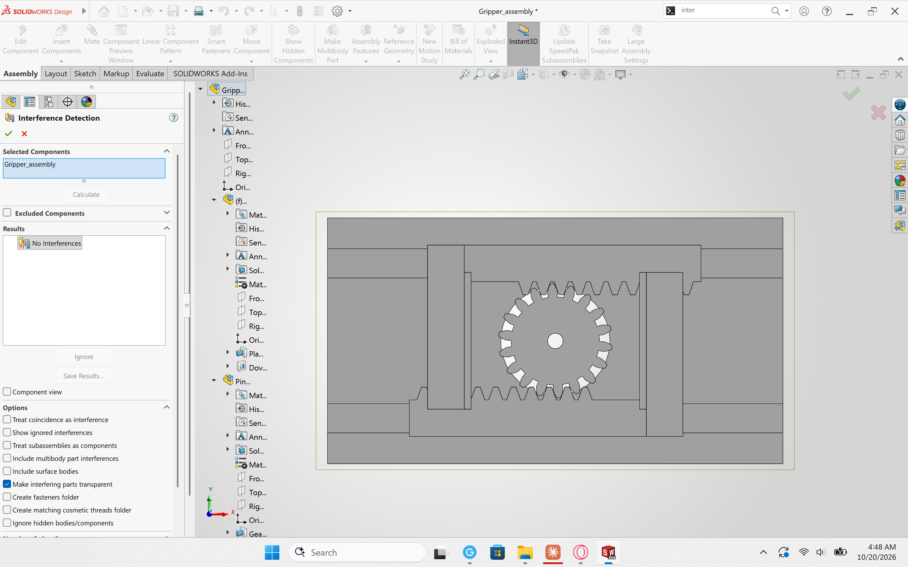
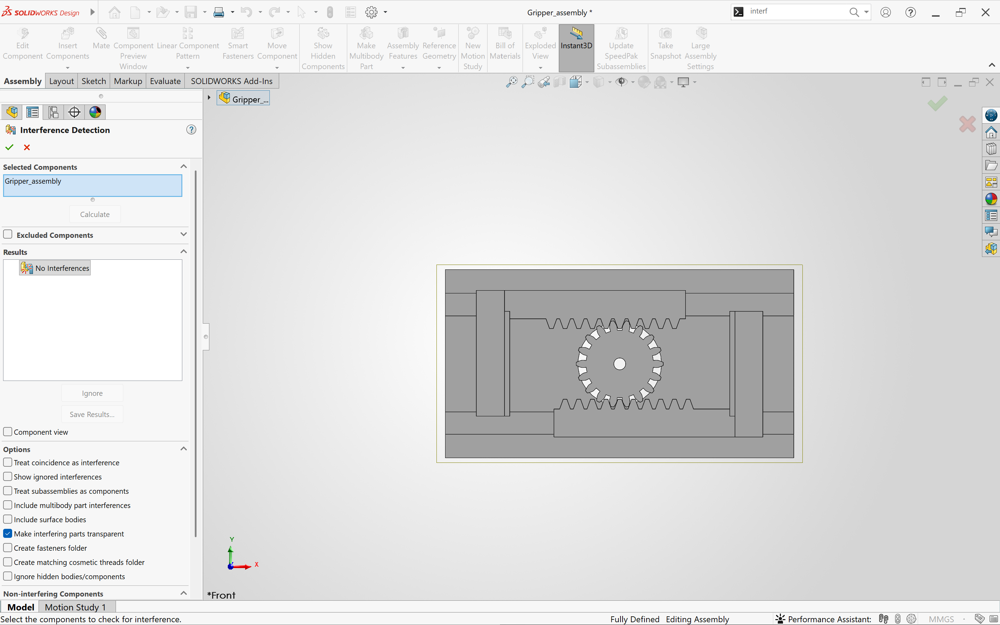
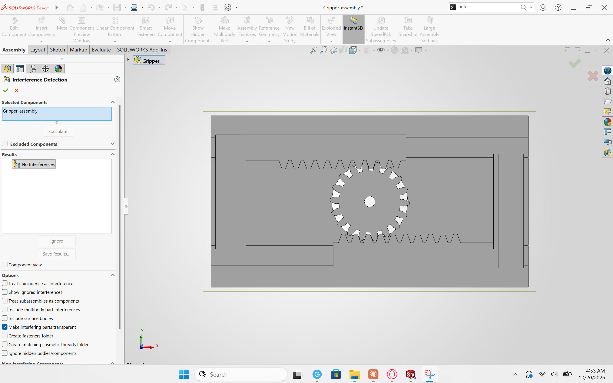
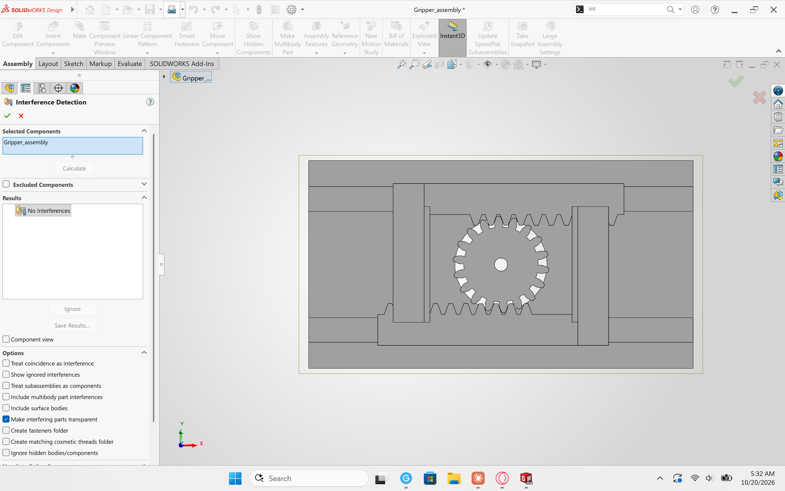
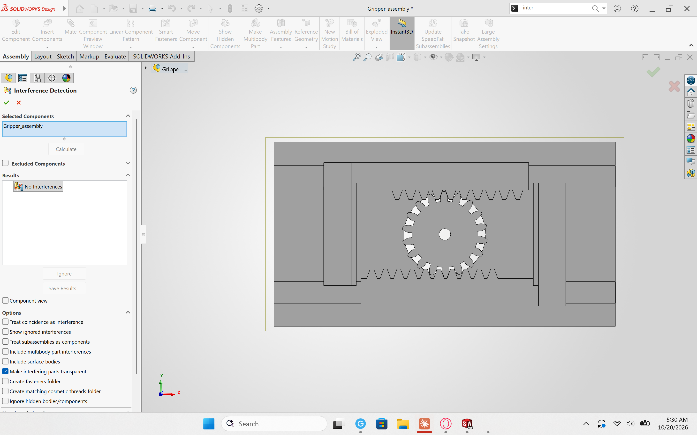
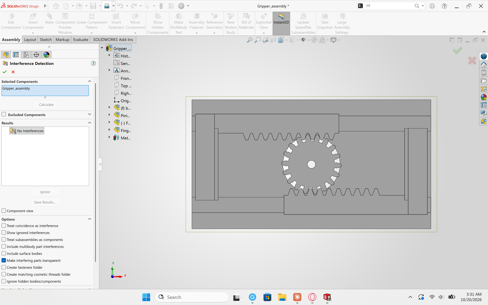

## 2026-10-18 - Project start: spec, sizing analysis, and core CAD sprint

- Payload object: Deer Park water bottle, 512 g (511.2 g on a second scale as a cross-check), sealed and full. Grip at 120 mm from base, on the label (does not twist). Side approach.
- First bottle measurements (125 mm grip height, 215 mm circumference) were measuring errors and were redone.
- Egg: spec written around the USDA Grade A Large class instead of specific eggs. 5-egg sample measured for circumference and mass on Scale B in a bowl (eggs rolled off Scale A). Length not recorded; width sets the jaw range and mass sets the grip force.
- Scale B (Etekcity, Max 5 kg, d = 1 g) displayed one decimal place despite its 1 g label; masses recorded as displayed and treated as ±1 g.
- Set egg design range (41–48 mm, 48–73 g) and jaw opening (37–78 mm, stroke 41 mm).
- Mechanism: decision matrix in progress.
- Derived numbers (bottle diameter, egg design ranges, jaw opening) independently recomputed from the raw CSVs; all match.
- Payload and fragile handling rows set.
- Force control and durability rows set; every spec row now has a number and a test method. Setpoint values come from the sizing analysis.
- Jaw opening split into a CAD target (37–78 mm, includes 2 mm print allowance) and printed acceptance limits (≤ 39 mm closed, ≥ 76 mm open).
- Mechanism chosen: rack and pinion (weighted decision matrix).
- Sizing assumptions set: μ = 0.4, SF = 2.0, η = 0.5, servo torque from the 4.8 V rating. Pad material: solid neoprene, about 1.5 mm (to buy).
- Grip force sized: setpoints 1.8 N (egg), 7.2 N (midway), 12.6 N (bottle) per pad. Free-body diagram added.
- Kinematics: pinion module 1.25 mm, 18 teeth (r = 11.25 mm); full stroke uses 104° of servo rotation.
- Core CAD parts modeled in SOLIDWORKS: pinion, finger-rack, base plate. Involute pinion and rack profiles generated in Python; rack-pinion mesh checked in 2D (no overlap, 0.15 mm backlash offset).
- Torque sized: 567 N·mm (5.78 kg·cm) required. MG996R chosen (+63% margin steady, +35% at peak); SG90 insufficient (31%). Datasheet travel ~120°: measure on arrival.
- Finger-rack fix: the arm, sensor pocket and pad had been extruded on the wrong side of the Right Plane, so the pad faced outward. Reversed all three.
- Assembly rebuilt from scratch (Gripper_assembly) after a side-view check showed a flipped mate had put the gear inside the plate. New mates use only planes and origins on the shared datum (Front Plane = sliding face, Top Plane through the pinion axis): gear Front–Front plus origin–origin; each rack Front–Front plus Top–Top (lower rack anti-aligned). Verified in front and side views: gear and racks in one layer on the plate, tongues inside the grooves, pads facing each other.
- Next: rack-pinion mates, 37–78 mm travel limits, interference check.
- Linked both racks to the gear with Rack Pinion mates (pinion pitch diameter 22.5 mm). Teeth were lined up first with temporary mates: gear Right Plane coincident with base_plate Right Plane, and each rack's Right Plane 33.10 mm from it. That centers the 6th rack tooth in the gear's top and bottom gaps, with a pad gap of 63.2 mm. The temporary mates were deleted before the Rack Pinion mates were added. Drag test from a screen recording: upper rack +2.44 mm gave 12.25° of clockwise gear rotation (predicted 12.43°) and lower rack -2.44 mm. Teeth stayed meshed. The upper rack's mate needed Reverse; the lower rack's mate was correct as created.

## 2026-10-20 - Interference check

- Interference check. The first run, done by dragging to the stops, showed tooth overlaps of up to 18.8 mm^3 between the pinion and both racks. I traced these to the Rack Pinion mates losing tooth timing as the jaws moved, not to the geometry. A 2D model of the gear and rack profiles reproduced the reported volumes with the gear 0.6 mm (closed) and 1.1 mm (open) out of step along its pitch circle, and it gives zero overlap with the teeth in step. I re-ran the check with exact positions set by standard mates: rack Right Planes 20.00 / 33.10 / 40.50 mm from center and gear angle 6.71° / 0° / 2.30°. Result: No Interferences at closed (37 mm), middle (63.2 mm) and open (78 mm). Then I re-created the Rack Pinion mates at the in-step middle position (both needed Reverse this time) and re-checked the moving mechanism with the whole assembly selected: No Interferences at 37, 52 and 78 mm.

*Exact positions, closed (37 mm): No Interferences.*

*Exact positions, middle (63.2 mm): No Interferences.*

*Exact positions, open (78 mm): No Interferences.*

*Moving mechanism with re-timed Rack Pinion mates, closed (37 mm): No Interferences.*

*Moving mechanism with re-timed Rack Pinion mates, 52 mm: No Interferences.*

*Moving mechanism with re-timed Rack Pinion mates, open (78 mm): No Interferences.*
