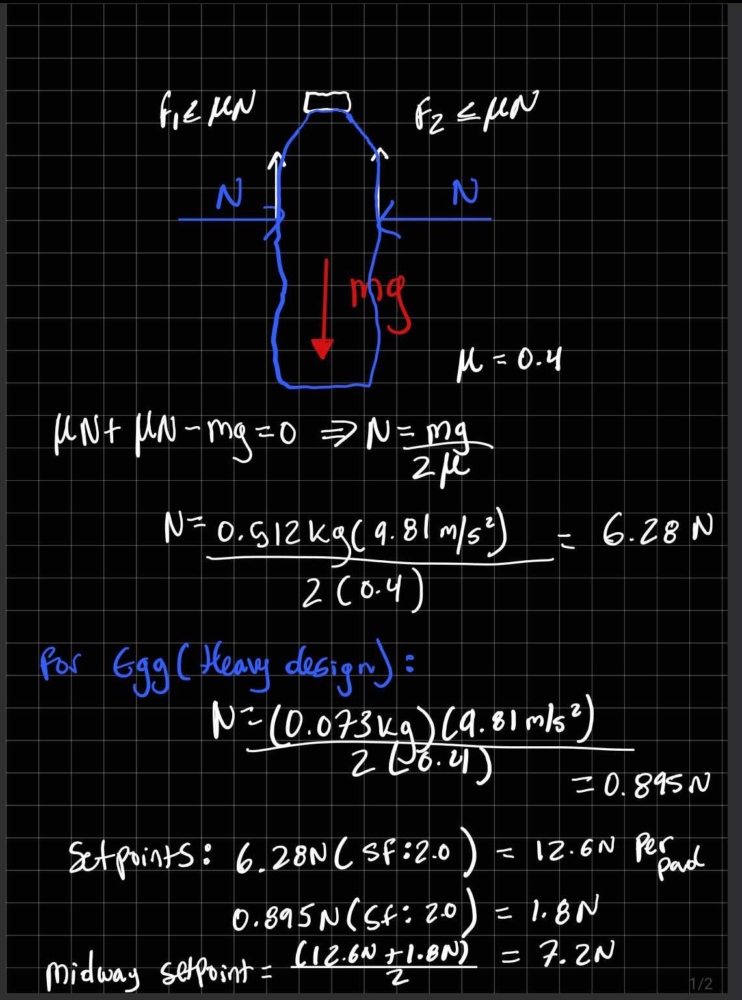

# Sizing analysis

Equations use GitHub math ($...$).

## Inputs
Data: [analysis/data/](../analysis/data/)

Raw data: analysis/data/. Bottle mass 512 g. Egg design mass range 48–73 g; the heavy end (73 g) is used for sizing. Jaw opening: CAD 37–78 mm, stroke 41 mm (docs/spec.md).

## Assumptions
<!-- Friction coefficient and its source, safety factor, mechanism efficiency, servo voltage -->

- Friction coefficient: μ = 0.4 (design value) for a solid neoprene pad, about 1.5 mm thick, on the bottle label and on eggshell. No published table lists these material pairs, so this is a conservative assumption: standard statics tables put dry rubber well above it (rubber on concrete: 0.60–0.90; Beer & Johnston, Vector Mechanics for Engineers: Statics, __ ed., Table 8.1). Verified by tilt test once the pad material is in hand: bottle on a pad-covered board with its axis pointing downhill so it slides instead of rolling, egg lying lengthwise; μ = tan(angle at which sliding starts). If the measured μ is below 0.4, redo the sizing with the measured value.
- Safety factor on grip force: SF = 2.0, built from named sources that multiply:

  | Source | What it covers | Factor |
  |---|---|---|
  | Force-control error | Spec allows actual force 15% below the setpoint | 1/0.85 = 1.18 |
  | μ uncertainty | Contamination or a slicker spot; μ dropping 20% (0.4 to 0.32) | 1.25 |
  | Load jolts | Jolt when the support is removed, or a brisk hand lift (about 0.2 g extra) | 1.2 |
  | FSR calibration | Sensor reading up to 10% high | 1.11 |
  | Combined | 1.18 × 1.25 × 1.2 × 1.11 ≈ 1.96 | rounded to 2.0 |

  The tilt test and FSR calibration will replace the μ and calibration allowances with measured values. For the egg, the setpoint must also stay well below the shell's cracking force.
- Mechanism efficiency: η = 0.5 (design value). Covers friction in the printed gear mesh and rails, including rail friction from the bottle's weight hanging off the fingertips. To be measured after the build.
- Servo torque: use the datasheet stall torque at 4.8 V, even though the servo will run at 5–6 V, so the calculated torque errs on the safe side.
- Separation of margins: SF covers grip-force uncertainty, η covers drive losses, and the 25% torque margin covers servo uncertainty. None of them covers the same thing twice.

## Grip force

Free-body diagram: the object hangs between two pads. Each pad presses with normal force N and supplies friction f ≤ μN upward; the weight mg acts downward.

At the moment of slipping, the vertical balance gives

$$2\mu N = mg \quad\Rightarrow\quad N = \frac{mg}{2\mu}$$

with g = 9.81 m/s² and μ = 0.4.

| Object | m (kg) | mg (N) | Minimum N per pad (N) | Setpoint = SF × N (N) |
|---|---|---|---|---|
| Bottle | 0.512 | 5.02 | 6.28 | 12.6 |
| Heavy design egg | 0.073 | 0.716 | 0.895 | 1.8 |

Midway setpoint: 7.2 N, the midpoint of the egg and bottle setpoints. Setpoints are per-pad normal forces, which is what the FSR in one pad measures.

Egg check: the peak limit is 1.2 × 1.8 = 2.2 N. A study of Hisex Brown hen eggs measured average rupture forces of 39.37 N (free-range) and 37.68 N (aviary) (South African Journal of Animal Science 49(3), 2019: https://scielo.org.za/pdf/sajas/v49n3/07.pdf), so the peak stays about 17–18× below typical breaking force. Eggshells resist distributed loads far better than point loads (Hahn et al., Journal of the Royal Society Interface 14(126), 2017, doi:[10.1098/rsif.2016.0804](https://doi.org/10.1098/rsif.2016.0804)), which supports using rubber pads.

## Kinematics: jaw gap vs. servo angle

Rack and pinion: each rack moves rθ (θ in radians) and both jaws move, so the gap changes by 2rθ:

$$w(\theta) = w_{closed} + 2r\theta$$

with w_closed = 37 mm (CAD). Covering the 41 mm stroke needs θ = 41 / (2r).

Pinion: module 1.25 mm, z = 18 teeth, 20° pressure angle, so r = (module × z)/2 = 11.25 mm (pitch diameter 22.5 mm).
- Full stroke uses θ = 41 / (2 × 11.25) = 1.822 rad = 104° of servo rotation, inside the MG996R datasheet's stated travel of about 120° (60° each way), with about 16° to spare. Measure the actual travel when the servo arrives; if it is under about 110°, resize the pinion.
- 18 teeth avoids undercut at a 20° pressure angle (theoretical minimum 2 / sin²(20°) ≈ 17.1).
- A 1.25 mm module gives teeth large enough to print cleanly on an FDM printer.
- The jaw gap changes by 2r × π/180 ≈ 0.39 mm per degree of servo rotation.

Alternative considered: module 1 mm, 18 teeth (r = 9 mm, 130° of rotation) needs about 20% less torque, but has smaller teeth and uses more of the servo's range. It would also need 130° of rotation, more than the datasheet's ~120°.

## Servo torque (worst case)

The pinion drives both racks, so it supplies both pads' forces at the pitch radius, and drive losses divide by η:

$$T = \frac{2Fr}{\eta}$$

The worst case is the bottle setpoint, F = 12.6 N per pad. Rack and pinion has a constant torque-to-force ratio, so the worst case is the same at every point in the stroke.

Steady hold: T = 2 × 12.6 N × 11.25 mm / 0.5 = 567 N·mm = 5.78 kg·cm (1 kg·cm = 98.07 N·mm).

Closing peak (the spec allows 1.2 × setpoint): 1.2 × 567 = 680 N·mm = 6.94 kg·cm.

## Servo comparison
<!-- Stall torque at my voltage, converted to N·mm -->

| Servo | Stall torque at 4.8 V | N·mm | Source |
|---|---|---|---|
| SG90 | 1.8 kgf·cm | 177 | TowerPro SG90 datasheet: https://tams.informatik.uni-hamburg.de/lehre/2023ss/vorlesung/es/doc/sg90.pdf |
| MG996R | 9.4 kgf·cm | 922 | TowerPro MG996R datasheet: https://people.ece.cornell.edu/land/courses/ece4760/FinalProjects/f2017/kmv48_rp625/kmv48_rp625/kmv48_rp625/MG996RTowerPro.pdf |

## Margin
<!-- State what it is measured against -->

Margin = stall torque at 4.8 V ÷ required torque − 1 (measured against stall torque).

| Servo | vs. steady hold (567 N·mm) | vs. closing peak (680 N·mm) |
|---|---|---|
| SG90 | supplies 31% of required (fails) | supplies 26% of required (fails) |
| MG996R | +63% | +35% |

Gate: at least 25% margin over the worst case. The MG996R passes at both.

## Result

Final servo: TowerPro MG996R (metal gear). The kit's SG90 supplies about a third of the required torque, so it is used only for unloaded motion tests. During the 30 s bottle hold, the MG996R sits at about 62% of its stall torque at zero speed, so expect it to warm up; rest between trials. Its datasheet stall current is 2.5 A at 6 V, so set the bench supply's current limit to about 2.5 A for the build.

## CAD dimensions

- Pinion face width: 8 mm. Check at the servo's full stall torque (922 N·mm at 4.8 V): each of the two meshes carries 922 / (2 × 11.25) ≈ 41 N. Lewis bending stress σ = W / (b·m·Y) = 41 / (8 × 1.25 × 0.31) ≈ 13 MPa (form factor Y ≈ 0.31 for 18 teeth at 20°), well below the strength of printed PLA; confirm against the filament's datasheet.
- Pinion bore: Ø3.4 mm, clearance for the M3 horn screw. The horn hole pattern is added once the MG996R is in hand.
- Rack: module 1.25 mm, 20° pressure angle, straight-sided teeth, 10 teeth (39.3 mm of teeth). The teeth run from 10 mm to about 49 mm from the pad surface, so the rack stays engaged with the pinion across the full 41 mm stroke.
- Backlash: the rack pitch line sits 0.15 mm farther from the pinion axis than the pitch radius (11.40 mm instead of 11.25 mm), which gives about 2 × 0.15 × tan 20° ≈ 0.11 mm of backlash along the pitch line.
- Rack body: 60 mm long (from 8 mm behind the finger's inner face to 52 mm in front of it), top 21 mm above the pinion axis, 8 mm thick to match the pinion.
